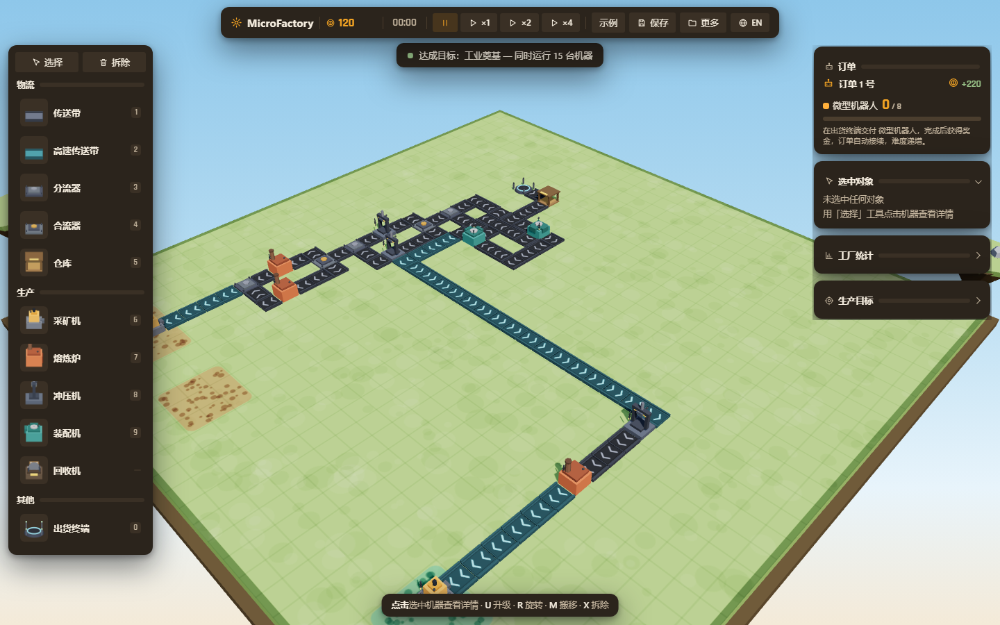
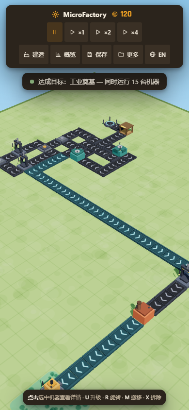

# MicroFactory

[简体中文](README.md) · **English** · [CI](https://github.com/LINYEANSHU/microfactory/actions/workflows/ci.yml)


**Build a line, watch a jam travel upstream, then find the bottleneck.**
MicroFactory is a single-player 3D automation game: mine, smelt, press, assemble and ship.
Order income pays for upgrades and expansion. Game state stays in your browser, with no account or backend service.



<details>
<summary>View the narrow layout (390 × 844)</summary>



</details>

Captured during the November 6, 2026 desktop Chromium review using SwiftShader for CPU WebGL rendering. The narrow viewport is not a physical-phone test.

## Why the line stops

- **Items occupy space.** Belts have capacity and minimum spacing; a full destination blocks upstream traffic and stops machines.
- **Ports define connections.** Green arrows mark inputs, orange arrows outputs; splitters, mergers and storage distribute the flow.
- **Processing adds value.** Iron and copper become ingots, gears, wire and circuits, then micro-robots ready to ship.
- **Expansion needs diagnosis.** Statistics show utilization, shipment rates and blocked/starved-machine advice. Machines reach level 3.
- **Surplus can be recycled.** The recycler breaks products back into ingots along their crafting tree.

Connect one working line, then inspect its buffers and bottlenecks. Orders and milestones supply the next targets.

## Getting started

Requires Node.js 22.12 or a newer 22.x release (or 24.x), npm and a modern browser with WebGL 2 support.

```bash
git clone https://github.com/LINYEANSHU/microfactory.git
cd microfactory
npm ci
npm run dev
```

Open the address printed in the terminal, normally `http://localhost:5173`.
Choose “Load demo factory” on first launch, or “Demo” in the toolbar, to watch a complete line. Chinese and English UI are available.

```bash
npm run build       # output: dist/
npm run preview     # preview the production build
```

If Windows PowerShell blocks npm scripts, use `npm.cmd` for the same commands.

## Controls

| Input | Action |
| --- | --- |
| Left click / left-drag | Build or select / lay a conveyor run |
| Right-drag / middle-drag | Pan / orbit |
| Scroll / arrow keys | Zoom / pan |
| `1`–`0` | Select a building |
| `R` / `U` / `M` | Rotate / upgrade / move the selected machine |
| `X` / `Q` | Demolish tool / select tool |
| `Space` / `Escape` | Pause / cancel the current action |
| `H` / `F3` | Help / performance details |

Narrow layouts switch panels through “Build” and “Overview”; “More” holds import, export and secondary actions.

## Saves and migration

The game auto-saves every 20 seconds to the current browser's `localStorage`; manual saving is also available.
Use JSON export/import under “More” for backups or migration. Snapshots include a machine currently being moved.
Imports load into an isolated simulation before replacing the active factory.

A different browser profile, site address or port may use separate storage. Clearing site data removes local saves.
Export `microfactory-save.json` to keep a long-lived factory.

## Verification and limits

Re-run on November 6, 2026:

```bash
npm run typecheck
npm test
npm run build
```

- **38 / 38 tests passed**, covering production timing, back-pressure, recycling, economy, migration and long simulations.
- Simulation uses a fixed 30 Hz step independently of Three.js; tests check the item-conservation ledger.
- The same-day browser review covered 1440 × 900 and 390 × 844 layouts, language switching, saves, malformed imports and WebGL startup recovery.
- The game uses Three.js / WebGL 2. SwiftShader supplied CPU rendering for that review; the normal development command does not force CPU rendering.
- Physical phones, other browser engines and hardware-rendering performance were not verified. There is no universal FPS guarantee.

## Development entry points

`src/sim/` contains simulation and serialization, `src/render/` the scene and instanced drawing, and `src/ui/` the interface and synthesized audio.
See [PRODUCT.md](PRODUCT.md) and [DESIGN.md](DESIGN.md) for the product and design notes (Chinese).

## Contributors

[LINYEANSHU](https://github.com/LINYEANSHU)

## License and sources

Code: [MIT](LICENSE) © 2026 LINYEANSHU.
Built with [Three.js](https://threejs.org/), [TypeScript](https://www.typescriptlang.org/), [Vite](https://vite.dev/) and [Vitest](https://vitest.dev/).
The UI bundles a [Rajdhani](https://fonts.google.com/specimen/Rajdhani) font subset; third-party code and fonts retain their respective licenses.
Gameplay draws inspiration from [Factorio](https://factorio.com/) and [shapez](https://shapez.io/).
