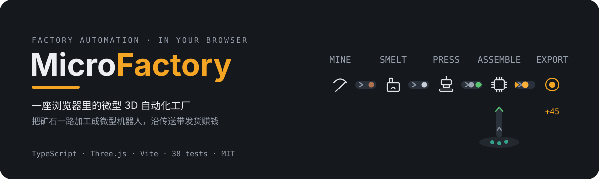
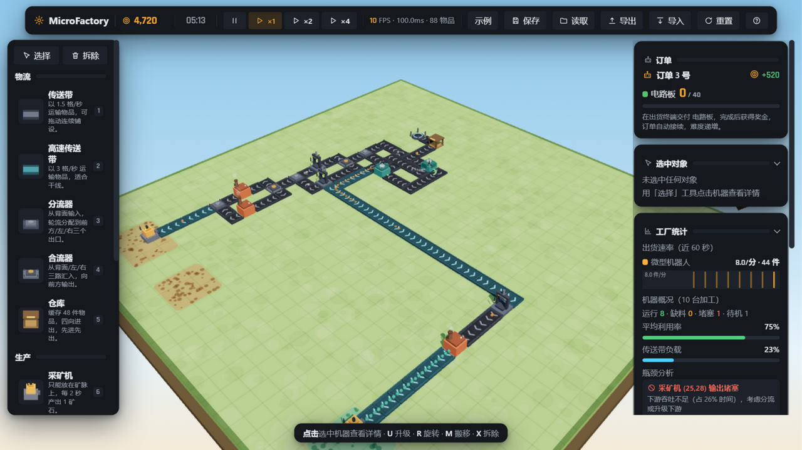

<div align="center">

[](https://github.com/LINYEANSHU/microfactory/actions/workflows/ci.yml)
[](LICENSE)

[简体中文](README.md) | **English**



</div>

A miniature 3D factory that fits in your browser: lay conveyors, build production lines, refine ore into micro-robots and ship them for credits. Built with **Three.js + TypeScript + Vite** — it runs entirely in your browser. No backend, no account, nothing to install.



## Features

- **Physical logistics with back-pressure** — belts hold 5 items per tile with a 0.25-tile minimum gap; items travel along straight and quarter-circle segments. When the downstream fills up, items genuinely jam and back-pressure propagates upstream — layout decides throughput.
- **A complete production chain** — extractors (ore patches only) → furnaces → presses → assemblers → export terminal, with splitters, mergers and storage (four-way, FIFO) tying the logistics together. Every machine and belt has clearly drawn input/output ports.
- **Recycler** — breaks surplus products back down into ingots along the crafting tree: gear → iron, 2 wire → copper, circuit → iron + copper, robot → 2 iron + copper. Ideal for relieving jams.
- **Orders & economy** — export prices: ore 0 · ingots 2 · wire 3 · gears 6 · circuits 15 · robots 45. The orders panel keeps issuing delivery tasks with bonuses; after nine orders an endless chain takes over, with ever-growing targets.
- **Machine upgrades** — levels 1→3 with ×1.5 / ×2.25 recipe speed; a three-bar signal lamp on each machine shows its level.
- **Stats & bottleneck analysis** — export rate (60-second window), machine states, average utilization, belt load, a credits/exported history chart and a per-second robot sparkline. The game points out blocked or starved machines and suggests fixes.
- **Milestones** — ten goals, from "First Shipment" to "Stockpile Master".
- **Fully synthesized sound** — seven WebAudio sound effects (place / remove / export / order / goal / upgrade / error), zero audio assets, one-click mute.
- **Bilingual UI (中文 / English)** — switch from the top bar; defaults to your browser language and remembers your choice in localStorage.
- **Saves** — auto-saved to localStorage every 20 seconds, with JSON import / export.

## How to play

The production chain (1 robot = 2 iron ore + 1 copper ore):

```
iron ⛏ ─→ furnace 🔥 ─→ ingot ─→ press 🔨 ─→ gear ─┬─→ assembler 🧩 ─→ circuit ─┐
                                                    │                            ├─→ assembler 🤖 ─→ robot ─→ storage → export
copper ⛏ ─→ furnace 🔥 ─→ ingot ─→ press 🔨 ─→ wire×2 ─┘                          ┘
```

- Machines have explicit **ports**: a green arrow marks the input, an orange arrow the output. Point a conveyor at the input and it feeds itself; machines push finished goods one tile ahead of their output port (machines can dock face-to-face, too).
- When the downstream is full, items **physically jam** and back-pressure stacks all the way upstream, halting machines — split the flow, speed it up, upgrade downstream, or check the "Bottlenecks" panel for advice.
- Conveyors corner automatically; **turbo conveyors** (3 tiles/s) shine on long main lines, and belts can merge sideways into each other.

### Controls

| Input | Action |
| --- | --- |
| Left click | Build / select (drag to lay a whole conveyor run) |
| Right-drag | Pan |
| Middle-drag / scroll / arrows | Orbit / zoom / pan |
| `1`-`0` | Hot-select buildings |
| `R` / `U` | Rotate building / upgrade selection |
| `M` | Move selection (contents kept) |
| `X` / `Q` | Demolish tool / select tool |
| `Space` | Pause / resume |
| `F3` | Performance details (frame time / draw calls) |
| `H` | Help |

## Getting started

```bash
git clone https://github.com/LINYEANSHU/microfactory.git
cd microfactory
npm install     # install dependencies (Node ≥ 22)
npm run dev     # dev server → http://localhost:5173 (rolls to the next port if busy)
```

Other commands:

```bash
npm run build       # production build → dist/
npm run preview     # preview the production build
npm run test        # headless simulation tests (vitest, no browser needed)
npm run typecheck   # TypeScript type check
```

> Desktop Chrome or Edge is recommended. A welcome dialog appears on first launch — click "Load demo factory" to watch a complete production line in action.

## Architecture

**Simulation and rendering are fully separated**: `src/sim/` is pure logic with zero Three.js dependencies, driven at a **fixed 30 Hz time step**, so changing speed or pausing never alters the physics; `src/render/` is the presentation layer; `src/ui/` holds the interface and sound.

```
src/
  core/defs.ts        item / recipe / machine definitions (shared by sim & render)
  sim/engine.ts       simulation engine: grid, belts, machines, ledger, serialization
  sim/example.ts      demo factory layout
  render/world.ts     scene / camera / lighting / floating-island environment
  render/models.ts    machine models & moving-part animation
  render/view.ts      merged belt meshes, instanced items, ghost preview & picking
  render/icons.ts     offscreen 3D icons for the build palette
  ui/i18n.ts          zh / en dictionary (type-checked for key parity)
  ui/hud.ts           the whole interface: build palette / inspector / stats / goals / modals
  ui/sound.ts         WebAudio synthesized sound effects
  main.ts             game loop, input, tools, saves
  test/               headless simulation tests (vitest)
```

- **Item conservation ledger**: `produced − consumed − exported − destroyed === items on the field`, checked for zero error throughout the tests; nothing spawns or vanishes unaccounted.
- **Performance**: belts are on-demand merged meshes with a single scrolling-UV material; items are drawn with one `InstancedMesh` per type (one draw call each); machines share a material cache. In an in-page benchmark the whole frame pipeline (sim + animation + render) averages about 1 ms at 1080p.

## Tests

```bash
npm run test    # = vitest run, 38 tests
```

Covered: production beats, jam back-pressure and recovery, splitter fairness, mergers and machine-to-machine docking, belt physics (capacity / saturation / corner arcs), recycler end-to-end and mixed feeding, export pricing, upgrade costs, the order chain, v1→v2 save migration with item-by-item in-flight restore, 900 s and 2400 s continuous runs of the demo factory, a 600 s factory with 30 extractors, and more. Every test asserts **zero conservation error**.

## References & acknowledgements

- [Three.js](https://threejs.org/) — 3D rendering
- [TypeScript](https://www.typescriptlang.org/) and [Vite](https://vite.dev/) — language and build
- [Vitest](https://vitest.dev/) — test framework
- [Rajdhani](https://fonts.google.com/specimen/Rajdhani) (Google Fonts, self-hosted latin subset) — UI numerals and latin type
- Gameplay inspired by [Factorio](https://factorio.com/) and [shapez](https://shapez.io/)

## License

[MIT](LICENSE) © 2026 LINYEANSHU
