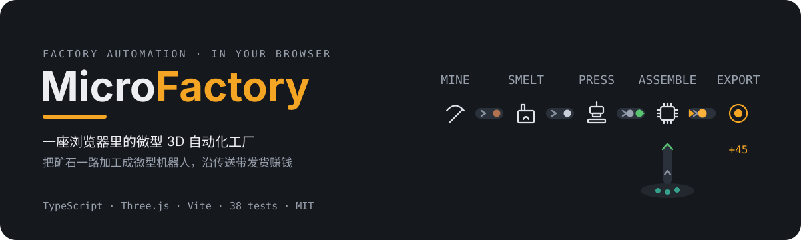
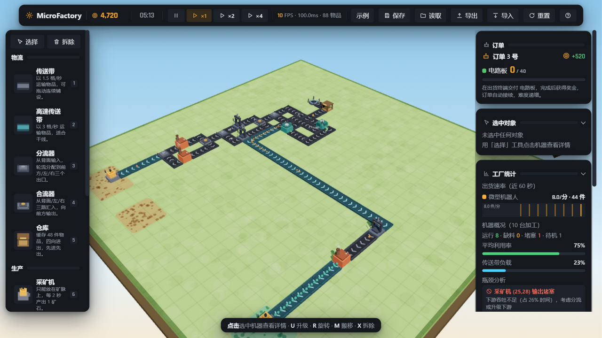

<div align="center">

[](https://github.com/LINYEANSHU/microfactory/actions/workflows/ci.yml)
[](LICENSE)

**简体中文** | [English](README.en.md)



</div>

一座属于你的微型 3D 自动化工厂：铺设传送带、建造产线，把矿石一路加工成微型机器人出货赚钱。基于 **Three.js + TypeScript + Vite**，纯浏览器本地运行——无后端、无登录、无安装。



## 特性

- **真实物流与背压** — 传送带每格 5 件、最小间距 0.25 格，物品沿直线与四分之一圆弧移动；下游满载会真实堵住并一路反压到上游——布局决定产能。
- **完整生产链** — 采矿机（限矿脉）→ 熔炼炉 → 冲压机 → 装配机 → 出货终端，分流器 / 合流器 / 仓库（四向进出、先进先出）衔接物流；机器与传送带都有明确的输入输出端口。
- **回收机** — 把多余成品按制造树拆回原料锭：齿轮→铁锭、2铜线→铜锭、电路板→铁锭+铜锭、机器人→2铁锭+铜锭。堵线时用它泄洪。
- **订单与经济** — 出货单价：原矿 0 · 锭 2 · 铜线 3 · 齿轮 6 · 电路板 15 · 机器人 45；订单面板持续下达交付任务并发放奖金，走完 9 单后进入无限订单（目标与奖励持续增长）。
- **机器升级** — 1→3 级，配方速度 ×1.5 / ×2.25，机器角落的信号灯显示当前等级。
- **统计与瓶颈分析** — 出货速率（60 秒滑窗）、机器状态概览、平均利用率、传送带负载、资金与累计出货历史曲线、机器人产能 sparkline；自动指出堵塞或缺料的机器并给出建议。
- **生产目标** — 10 个里程碑，从「首批出货」到「仓储大师」。
- **纯合成音效** — WebAudio 实时合成 7 种提示音（放置 / 拆除 / 出货 / 订单 / 目标 / 升级 / 错误），零素材文件，可一键开关。
- **中英双语界面** — 顶栏一键切换，默认跟随浏览器语言，选择保存在 localStorage。
- **存读档** — 浏览器 localStorage 每 20 秒自动保存，支持 JSON 存档导入 / 导出。

## 玩法

生产链（1 台机器人 = 2 铁矿 + 1 铜矿）：

```
铁矿 ⛏ ─→ 熔炼炉 🔥 ─→ 铁锭 ─→ 冲压机 🔨 ─→ 齿轮 ─┬─→ 装配机 🧩 ─→ 电路板 ─┐
                                                  │                        ├─→ 装配机 🤖 ─→ 微型机器人 ─→ 仓库 → 出货
铜矿 ⛏ ─→ 熔炼炉 🔥 ─→ 铜锭 ─→ 冲压机 🔨 ─→ 铜线×2 ─┘                        ┘
```

- 机器有明确的**端口**：绿色箭头 = 输入，橙色箭头 = 输出；传送带指向输入口即可自动上料，机器从输出口向前方一格推送成品（机器之间也可以直接贴脸对接）。
- 下游满载时，物品会**真实堵塞**并一路反压到上游，机器随之停产——分流、提速或升级下游，看「瓶颈分析」的建议。
- 传送带拐弯自动成型；**高速传送带**（3 格/秒）适合长距离干线；传送带可以互相侧向汇入。

### 操作

| 输入 | 功能 |
| --- | --- |
| 左键 | 建造 / 选择（传送带支持拖动连续铺设） |
| 右键拖动 | 平移视角 |
| 中键拖动 / 滚轮 / 方向键 | 旋转视角 / 缩放 / 平移 |
| `1`-`0` | 快速选择建筑 |
| `R` / `U` | 旋转建筑 / 升级选中机器 |
| `M` | 搬移选中机器（保留内部物品） |
| `X` / `Q` | 拆除工具 / 选择工具 |
| `空格` | 暂停 / 继续 |
| `F3` | 性能详情（帧耗时 / draw calls） |
| `H` | 帮助 |

## 快速开始

```bash
git clone https://github.com/LINYEANSHU/microfactory.git
cd microfactory
npm install     # 安装依赖（Node ≥ 22）
npm run dev     # 开发模式 → http://localhost:5173（端口被占用时自动顺延）
```

其他命令：

```bash
npm run build       # 生产构建 → dist/
npm run preview     # 预览生产构建
npm run test        # 无头模拟测试（vitest，不需要浏览器）
npm run typecheck   # TypeScript 类型检查
```

> 推荐 Chrome / Edge 桌面版。首次打开会弹出欢迎窗口，点「加载示例工厂」即可观看一条完整的生产线。

## 架构

**模拟与渲染完全分离**：`src/sim/` 是纯逻辑（零 Three.js 依赖），以 **30Hz 固定时间步长**驱动，变速 / 暂停不影响物理结果；`src/render/` 负责表现；`src/ui/` 是界面与音效。

```
src/
  core/defs.ts        物品 / 配方 / 机器定义（模拟与渲染共享）
  sim/engine.ts       模拟引擎：网格、传送带、机器、账本、序列化
  sim/example.ts      示例工厂布局
  render/world.ts     场景 / 相机 / 光照 / 浮岛环境
  render/models.ts    机器模型与运动部件动画
  render/view.ts      传送带合并网格、物品实例化、预览与拾取
  render/icons.ts     建造面板 3D 图标离屏渲染
  ui/i18n.ts          中英双语字典（类型同构，缺键即编译错误）
  ui/hud.ts           全部界面：建造面板 / 检视器 / 统计 / 目标 / 模态框
  ui/sound.ts         WebAudio 合成音效
  main.ts             主循环、输入、工具、存读档
  test/               无头模拟测试（vitest）
```

- **物品守恒记账**：`produced − consumed − exported − destroyed === 场上现存`，测试逐段校验误差为 0；不存在凭空生成或重复消耗。
- **性能**：传送带为按需重建的合并网格（单一滚动 UV 材质），物品按类型用 `InstancedMesh` 实例化（每类型 1 次 draw call），机器共享材质缓存。页内基准下整帧流水线（模拟 + 动画 + 渲染）平均约 1ms/帧（1080p）。

## 测试

```bash
npm run test    # = vitest run，38 项
```

覆盖：基础生产节拍、堵塞回流与恢复、分流公平性、合流与机器直连、传送带物理（间距 / 满载 / 拐弯弧线）、回收机整线与混合进料、经济计价、升级扣款、订单链、v1→v2 存档迁移与逐件在途物品恢复、示例工厂 900 秒 / 2400 秒连续运行、600 秒大规模工厂（30 台采矿机）等。所有测试断言**物品守恒误差为 0**。

## 参考与致谢

- [Three.js](https://threejs.org/) — 3D 渲染
- [TypeScript](https://www.typescriptlang.org/) 与 [Vite](https://vite.dev/) — 语言与构建
- [Vitest](https://vitest.dev/) — 测试框架
- [Rajdhani](https://fonts.google.com/specimen/Rajdhani)（Google Fonts，自托管 latin 子集）— 界面数字与拉丁字体
- 玩法灵感来自 [Factorio](https://factorio.com/) 与 [shapez](https://shapez.io/) 

## License

[MIT](LICENSE) © 2026 LINYEANSHU
